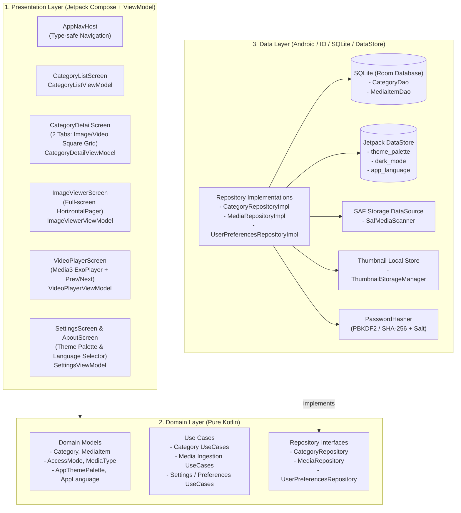
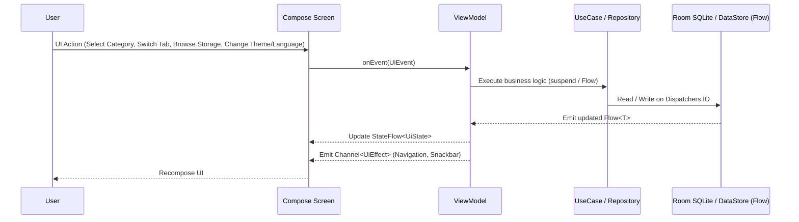

# 01. System Architecture (Clean Architecture + MVVM / UDF)

This document defines the overall architecture of **MediaArchive**, built upon **Clean Architecture and MVVM (Unidirectional Data Flow)** following official Google Android architecture guidance. The structure is modular-ready, testable, and scalable.

---

## 1. Layered Architecture Diagram



---

## 2. Dependency Rule

- **Dependency Direction**: `Presentation` $\rightarrow$ `Domain` $\leftarrow$ `Data`.
- **Domain Layer**: Pure Kotlin only. No imports from `android.*`, `androidx.compose.*`, or `androidx.room.*`.
- **Data Layer**: Implements repository interfaces defined in `Domain` and maps database/storage entities to Domain models.
- **Presentation Layer**: Consumes `Domain` UseCases/Repositories and exposes immutable `StateFlow<UiState>` to Jetpack Compose screens.

---

## 3. Unidirectional Data Flow (UDF)

Every feature screen follows a strict unidirectional cycle:



---

## 4. Scalable Package Structure

```text
app/src/main/java/com/mediaarchive/app/
├── MediaArchiveApplication.kt             # @HiltAndroidApp
├── MainActivity.kt                        # AppCompatActivity (for per-app locale support) + Compose NavHost
├── navigation/
│   ├── AppNavHost.kt                      # Centralized Navigation Graph
│   └── AppDestination.kt                  # Type-safe Routes (@Serializable)
├── core/
│   ├── common/                            # Coroutine Dispatchers, Result wrapper, Extensions
│   ├── designsystem/                      # Multi-Theme Palettes (Neutral Taupe, Crimson, Forest, Sapphire)
│   ├── localization/                      # AppLocaleManager (English, Vietnamese, Japanese)
│   └── security/                          # PasswordHasher, WindowSecureFlagEffect
├── domain/
│   ├── model/
│   │   ├── Category.kt
│   │   ├── AccessMode.kt                  # enum: PUBLIC, PRIVATE
│   │   ├── MediaItem.kt
│   │   ├── MediaType.kt                   # enum: IMAGE, VIDEO
│   │   ├── AppThemePalette.kt             # enum: NEUTRAL_TAUPE, DEEP_CRIMSON, DEEP_FOREST, DEEP_SAPPHIRE
│   │   └── AppLanguage.kt                 # enum: ENGLISH("en"), VIETNAMESE("vi"), JAPANESE("ja")
│   ├── repository/
│   │   ├── CategoryRepository.kt
│   │   ├── MediaRepository.kt
│   │   └── UserPreferencesRepository.kt
│   └── usecase/
│       ├── category/
│       │   ├── GetCategoriesUseCase.kt
│       │   ├── CreateCategoryUseCase.kt
│       │   └── VerifyCategoryPasswordUseCase.kt
│       ├── media/
│       │   ├── GetMediaByCategoryUseCase.kt
│       │   ├── ImportSelectedMediaUseCase.kt
│       │   └── ImportFolderMediaUseCase.kt
│       └── settings/
│           ├── ObserveUserPreferencesUseCase.kt
│           ├── UpdateAppThemePaletteUseCase.kt
│           └── UpdateAppLanguageUseCase.kt
├── data/
│   ├── local/
│   │   ├── MediaArchiveDatabase.kt        # RoomDatabase + Default 'Main' Category Seed
│   │   ├── dao/
│   │   │   ├── CategoryDao.kt
│   │   │   └── MediaItemDao.kt
│   │   ├── entity/
│   │   │   ├── CategoryEntity.kt
│   │   │   └── MediaItemEntity.kt
│   │   └── preferences/
│   │       └── UserPreferencesDataSource.kt
│   ├── storage/
│   │   ├── SafMediaScanner.kt             # Single file & recursive folder scanner via SAF
│   │   └── ThumbnailStorageManager.kt     # Generates & stores thumbnails in filesDir/thumbnails/
│   ├── mapper/
│   │   ├── CategoryMapper.kt
│   │   └── MediaItemMapper.kt
│   ├── repository/
│   │   ├── CategoryRepositoryImpl.kt
│   │   ├── MediaRepositoryImpl.kt
│   │   └── UserPreferencesRepositoryImpl.kt
│   └── di/
│       ├── DatabaseModule.kt
│       ├── PreferencesModule.kt
│       ├── RepositoryModule.kt
│       └── StorageModule.kt
└── feature/
    ├── categorylist/                      # Category selection, creation, password prompt, Settings/About entry
    │   ├── CategoryListContract.kt
    │   ├── CategoryListViewModel.kt
    │   ├── CategoryListScreen.kt
    │   └── component/
    │       ├── CategoryCard.kt
    │       ├── CreateCategoryDialog.kt
    │       └── PasswordPromptDialog.kt
    ├── categorydetail/                    # 2 Separate Tabs (Images / Videos Square Grid) + Browse Storage
    │   ├── CategoryDetailContract.kt
    │   ├── CategoryDetailViewModel.kt
    │   ├── CategoryDetailScreen.kt
    │   └── component/
    │       ├── MediaSquareGrid.kt
    │       ├── MediaSquareGridItem.kt
    │       └── StorageBrowserBottomSheet.kt
    ├── imageviewer/                       # Full-screen Image Pager (Swipe left/right)
    │   ├── ImageViewerContract.kt
    │   ├── ImageViewerViewModel.kt
    │   └── ImageViewerScreen.kt
    ├── videoplayer/                       # Media3 Video Player + Previous / Next controller buttons
    │   ├── VideoPlayerContract.kt
    │   ├── VideoPlayerViewModel.kt
    │   ├── VideoPlayerScreen.kt
    │   └── component/
    │       └── VideoPlayerControlsOverlay.kt
    ├── settings/                          # Theme Palette switcher & Language selector (EN / VI / JA)
    │   ├── SettingsContract.kt
    │   ├── SettingsViewModel.kt
    │   └── SettingsScreen.kt
    └── about/                             # Concise user-facing introduction screen (no tech jargon)
        └── AboutScreen.kt
```

---

## 5. Technology Stack Summary

| Component | Library | Purpose |
| :--- | :--- | :--- |
| **UI Toolkit** | Jetpack Compose + Material 3 | Declarative UI, custom color schemes, `LazyVerticalGrid`, `HorizontalPager` |
| **Dependency Injection** | Dagger Hilt (`hilt-android`) | Compile-time DI for ViewModels, Repositories, Room, and DataStore |
| **Database (SQLite)** | AndroidX Room (`room-ktx`) | Local relational storage for Categories, Media URIs, and Thumbnail paths |
| **Preferences** | Jetpack DataStore (`datastore-preferences`) | Persisting selected Theme Palette and App Language |
| **Localization** | AndroidX AppCompat (`AppCompatDelegate.setApplicationLocales`) | Seamless runtime switching between English (`en`), Vietnamese (`vi`), and Japanese (`ja`) |
| **Image Loading** | Coil 3 (`coil-compose`) | Fast decoding of local `.webp` thumbnails and full-screen images |
| **Video Playback** | AndroidX Media3 (`media3-exoplayer`, `media3-ui`) | Playlist-aware video playback with Previous / Next controls |
| **Storage Access** | AndroidX DocumentFile (`documentfile`) + SAF | Manual file and folder picking without broad storage permissions |
