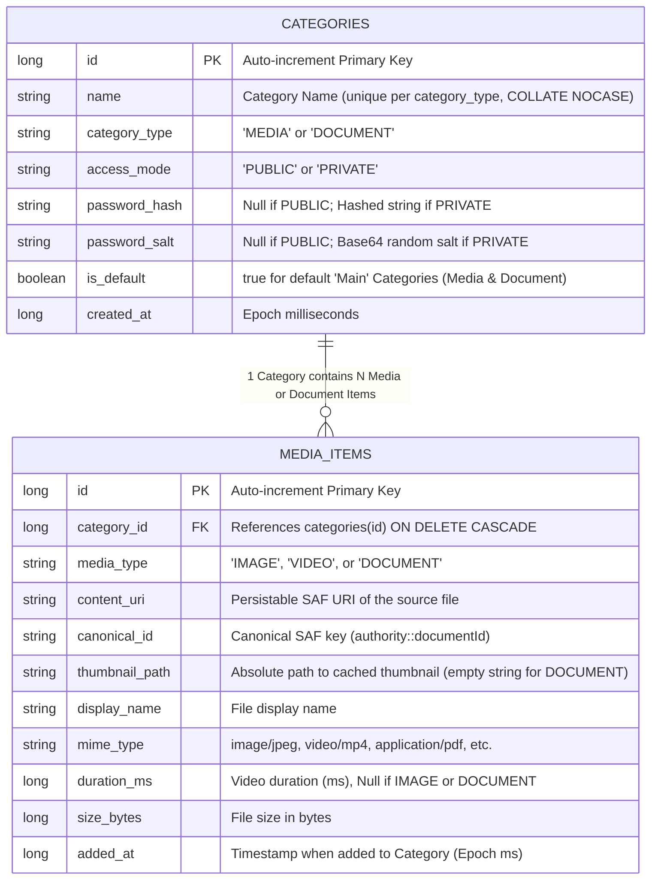

# 02. SQLite Database Schema (Room — Version 1)

This document details the consolidated relational schema, foreign keys, indexes, and default seeding mechanism in SQLite for **MediaArchive**.

---

## 1. Entity-Relationship Diagram (ERD)

---

## 2. `categories` Table Specification

Stores the two default `Main` Categories (`MEDIA` and `DOCUMENT`) and all user-created Categories.

| Column Name | SQLite Type | Constraints | Description |
| :--- | :--- | :--- | :--- |
| `id` | `INTEGER` | `PRIMARY KEY AUTOINCREMENT` | Unique Category identifier |
| `name` | `TEXT` | `NOT NULL COLLATE NOCASE` | Category name (unique per `category_type`) |
| `category_type` | `TEXT` | `NOT NULL DEFAULT 'MEDIA'` | `"MEDIA"` (Images/Videos) or `"DOCUMENT"` |
| `access_mode` | `TEXT` | `NOT NULL` | `"PUBLIC"` or `"PRIVATE"` |
| `password_hash` | `TEXT` | `NULLABLE` | Password digest (only populated when `access_mode = 'PRIVATE'`) |
| `password_salt` | `TEXT` | `NULLABLE` | Base64-encoded 16-byte random salt |
| `is_default` | `INTEGER` | `NOT NULL DEFAULT 0` | `1` (`true`) for default `"Main"` categories, `0` (`false`) for custom categories |
| `created_at` | `INTEGER` | `NOT NULL` | Creation timestamp (epoch ms) |

### Indexes & Default Seeding:
- **Unique Index**: `UNIQUE(name, category_type)` allows both `MEDIA` and `DOCUMENT` to have their own `"Main"` (and user-created categories with the same name across different types) while preventing duplicates within the same type.
- Executed via `RoomDatabase.Callback.onCreate()` and verified at startup (`ensureDefaultCategoryExists()`):
  - Seeds `('Main', 'MEDIA', 'PUBLIC', NULL, NULL, 1, now)`
  - Seeds `('Main', 'DOCUMENT', 'PUBLIC', NULL, NULL, 1, now + 1)`
- Queries always order by `is_default DESC, created_at ASC, id ASC` so the default `Main` categories appear first.

---

## 3. `media_items` Table Specification

Stores the source URI (`content_uri`), canonical deduplication key (`canonical_id`), and local thumbnail file path (`thumbnail_path`) for each image, video, or document assigned to a Category.

| Column Name | SQLite Type | Constraints | Description |
| :--- | :--- | :--- | :--- |
| `id` | `INTEGER` | `PRIMARY KEY AUTOINCREMENT` | Unique item identifier |
| `category_id` | `INTEGER` | `NOT NULL REFERENCES categories(id) ON DELETE CASCADE` | Owning Category ID |
| `media_type` | `TEXT` | `NOT NULL` | `"IMAGE"`, `"VIDEO"`, or `"DOCUMENT"` |
| `content_uri` | `TEXT` | `NOT NULL` | Persistable SAF URI (`content://...`) |
| `canonical_id` | `TEXT` | `NOT NULL` | Canonical SAF key (`authority::documentId`) preventing cross-URI duplicates |
| `thumbnail_path` | `TEXT` | `NOT NULL` | Internal `.webp` path for `IMAGE`/`VIDEO`; empty string `""` for `DOCUMENT` |
| `display_name` | `TEXT` | `NOT NULL` | Display filename |
| `mime_type` | `TEXT` | `NOT NULL` | MIME type (`image/*`, `video/*`, `application/pdf`, `text/plain`, etc.) |
| `duration_ms` | `INTEGER` | `NULLABLE` | Video duration in milliseconds (`NULL` for `IMAGE` and `DOCUMENT`) |
| `size_bytes` | `INTEGER` | `NOT NULL DEFAULT 0` | File size in bytes |
| `added_at` | `INTEGER` | `NOT NULL` | Insertion timestamp (epoch ms) |

### Indexes & Unique Constraints:
1. **`index_media_items_category_id_media_type_added_at`**:
   - Composite index on `(category_id, media_type, added_at)`.
   - Enables fast loading of Images/Videos tabs (in Media Categories) and Document lists (in Document Categories).
2. **`index_media_items_category_canonical_id` (UNIQUE)**:
   - Enforces `UNIQUE(category_id, canonical_id)` with `OnConflictStrategy.IGNORE`.
   - Prevents duplicate entries even when the same physical file is selected once via `OpenMultipleDocuments` and again via `OpenDocumentTree`.
