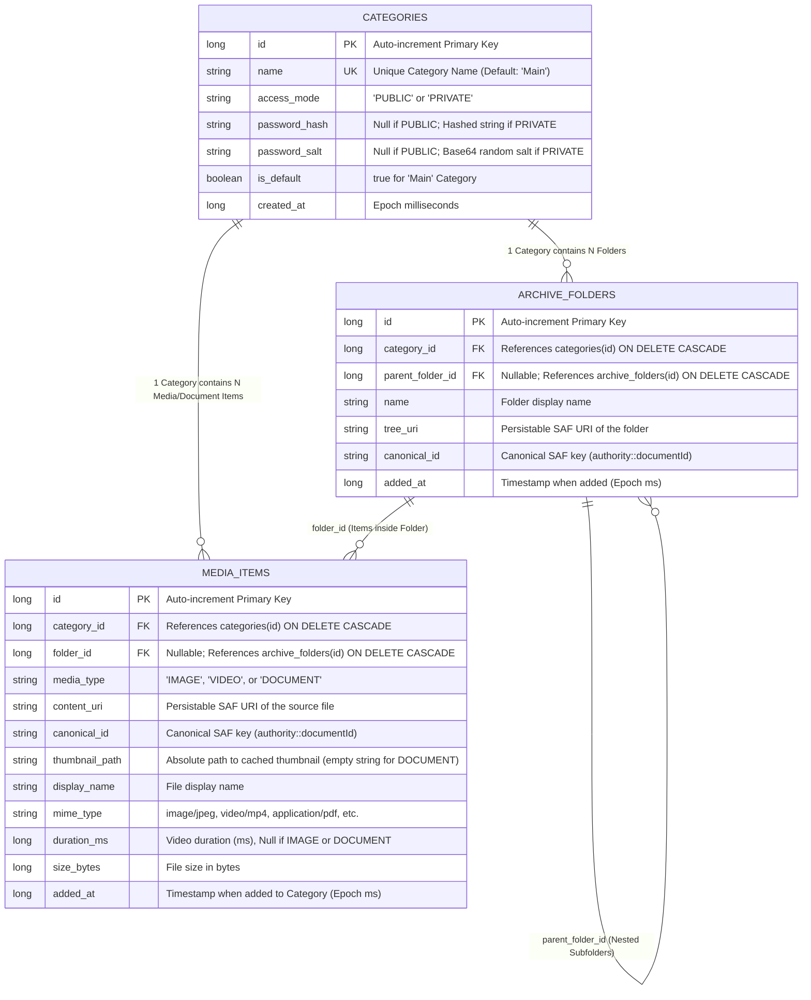

# 02. SQLite Database Schema (Room — Version 2)

This document details the relational schema, foreign keys, indexes, Room migration (`v1 -> v2`), and default seeding mechanism in SQLite for **MediaArchive**.

---

## 1. Entity-Relationship Diagram (ERD)



---

## 2. `categories` Table Specification

Stores the default `Main` Category and all user-created Categories.

| Column Name | SQLite Type | Constraints | Description |
| :--- | :--- | :--- | :--- |
| `id` | `INTEGER` | `PRIMARY KEY AUTOINCREMENT` | Unique Category identifier |
| `name` | `TEXT` | `NOT NULL UNIQUE COLLATE NOCASE` | Category name (e.g., `"Main"`, `"Travel"`, `"Vault"`) |
| `access_mode` | `TEXT` | `NOT NULL` | `"PUBLIC"` or `"PRIVATE"` |
| `password_hash` | `TEXT` | `NULLABLE` | Password digest (only populated when `access_mode = 'PRIVATE'`) |
| `password_salt` | `TEXT` | `NULLABLE` | Base64-encoded 16-byte random salt |
| `is_default` | `INTEGER` | `NOT NULL DEFAULT 0` | `1` (`true`) for `"Main"`, `0` (`false`) for custom categories |
| `created_at` | `INTEGER` | `NOT NULL` | Creation timestamp (epoch ms) |

### Seeding the Default `Main` Category:
- Executed via `RoomDatabase.Callback.onCreate()` and verified at startup (`ensureDefaultCategoryExists()`):
  ```sql
  INSERT OR IGNORE INTO categories (name, access_mode, password_hash, password_salt, is_default, created_at)
  VALUES ('Main', 'PUBLIC', NULL, NULL, 1, strftime('%s','now') * 1000);
  ```
- Queries always order by `is_default DESC, created_at ASC` so `Main` appears first.

---

## 3. `archive_folders` Table Specification *(Added in v2)*

Stores imported folders and nested subfolders to power Explorer-style drill-down navigation inside each Category.

| Column Name | SQLite Type | Constraints | Description |
| :--- | :--- | :--- | :--- |
| `id` | `INTEGER` | `PRIMARY KEY AUTOINCREMENT` | Unique folder identifier |
| `category_id` | `INTEGER` | `NOT NULL REFERENCES categories(id) ON DELETE CASCADE` | Owning Category ID |
| `parent_folder_id` | `INTEGER` | `NULLABLE REFERENCES archive_folders(id) ON DELETE CASCADE` | Parent folder ID (`NULL` = Category root level) |
| `name` | `TEXT` | `NOT NULL` | Folder display name |
| `tree_uri` | `TEXT` | `NOT NULL` | Persistable SAF URI of the folder |
| `canonical_id` | `TEXT` | `NOT NULL` | Canonical SAF key (`authority::documentId`) for deduplication |
| `added_at` | `INTEGER` | `NOT NULL` | Insertion timestamp (epoch ms) |

### Indexes & Unique Constraints:
1. **`index_archive_folders_category_parent_name`**:
   - Composite index on `(category_id, parent_folder_id, name)`.
   - Enables fast alphabetical listing of child folders at any Explorer depth.
2. **`index_archive_folders_category_canonical_id` (UNIQUE)**:
   - Enforces `UNIQUE(category_id, canonical_id)` with `OnConflictStrategy.IGNORE`.
   - Prevents importing the same physical folder twice into the same Category.

---

## 4. `media_items` Table Specification *(Updated in v2)*

Stores the source URI (`content_uri`), canonical deduplication key (`canonical_id`), optional parent folder (`folder_id`), and local thumbnail file path (`thumbnail_path`) for each image, video, or document assigned to a Category.

| Column Name | SQLite Type | Constraints | Description |
| :--- | :--- | :--- | :--- |
| `id` | `INTEGER` | `PRIMARY KEY AUTOINCREMENT` | Unique item identifier |
| `category_id` | `INTEGER` | `NOT NULL REFERENCES categories(id) ON DELETE CASCADE` | Owning Category ID |
| `folder_id` | `INTEGER` | `NULLABLE REFERENCES archive_folders(id) ON DELETE CASCADE` | Owning folder ID (`NULL` = Category root level) |
| `media_type` | `TEXT` | `NOT NULL` | `"IMAGE"`, `"VIDEO"`, or `"DOCUMENT"` (powers the 3 separate tabs) |
| `content_uri` | `TEXT` | `NOT NULL` | Persistable SAF URI (`content://...`) |
| `canonical_id` | `TEXT` | `NOT NULL` | Canonical SAF key (`authority::documentId`) preventing cross-URI duplicates |
| `thumbnail_path` | `TEXT` | `NOT NULL` | Internal `.webp` path for `IMAGE`/`VIDEO`; empty string `""` for `DOCUMENT` |
| `display_name` | `TEXT` | `NOT NULL` | Display filename |
| `mime_type` | `TEXT` | `NOT NULL` | MIME type (`image/*`, `video/*`, `application/pdf`, `text/plain`, etc.) |
| `duration_ms` | `INTEGER` | `NULLABLE` | Video duration in milliseconds (`NULL` for `IMAGE` and `DOCUMENT`) |
| `size_bytes` | `INTEGER` | `NOT NULL DEFAULT 0` | File size in bytes |
| `added_at` | `INTEGER` | `NOT NULL` | Insertion timestamp (epoch ms) |

### Indexes & Unique Constraints:
1. **`index_media_items_category_folder_type_added_at`**:
   - Composite index on `(category_id, folder_id, media_type, added_at DESC)`.
   - Enables instant $O(\log N)$ switching across **Images**, **Videos**, and **Documents** tabs at any folder level.
2. **`index_media_items_category_canonical_id` (UNIQUE)**:
   - Enforces `UNIQUE(category_id, canonical_id)` with `OnConflictStrategy.IGNORE`.
   - Prevents duplicate entries even when the same physical file is selected once via `OpenMultipleDocuments` and again via `OpenDocumentTree`.

---

## 5. Room Migration (`MIGRATION_1_2`)

Upgrading from database version `1` to `2` preserves all existing Categories and MediaItems:

```kotlin
val MIGRATION_1_2 = object : Migration(1, 2) {
    override fun migrate(db: SupportSQLiteDatabase) {
        // 1. Create archive_folders table
        db.execSQL("""
            CREATE TABLE IF NOT EXISTS archive_folders (
                id INTEGER PRIMARY KEY AUTOINCREMENT NOT NULL,
                category_id INTEGER NOT NULL,
                parent_folder_id INTEGER DEFAULT NULL,
                name TEXT NOT NULL,
                tree_uri TEXT NOT NULL,
                canonical_id TEXT NOT NULL,
                added_at INTEGER NOT NULL,
                FOREIGN KEY(category_id) REFERENCES categories(id) ON DELETE CASCADE,
                FOREIGN KEY(parent_folder_id) REFERENCES archive_folders(id) ON DELETE CASCADE
            )
        """.trimIndent())
        db.execSQL("""
            CREATE INDEX IF NOT EXISTS index_archive_folders_category_parent_name
            ON archive_folders (category_id, parent_folder_id, name)
        """.trimIndent())
        db.execSQL("""
            CREATE UNIQUE INDEX IF NOT EXISTS index_archive_folders_category_canonical_id
            ON archive_folders (category_id, canonical_id)
        """.trimIndent())

        // 2. Recreate media_items with folder_id & canonical_id (backfilled from content_uri)
        db.execSQL("""
            CREATE TABLE IF NOT EXISTS media_items_new (
                id INTEGER PRIMARY KEY AUTOINCREMENT NOT NULL,
                category_id INTEGER NOT NULL,
                folder_id INTEGER DEFAULT NULL,
                media_type TEXT NOT NULL,
                content_uri TEXT NOT NULL,
                canonical_id TEXT NOT NULL,
                thumbnail_path TEXT NOT NULL,
                display_name TEXT NOT NULL,
                mime_type TEXT NOT NULL,
                duration_ms INTEGER,
                size_bytes INTEGER NOT NULL DEFAULT 0,
                added_at INTEGER NOT NULL,
                FOREIGN KEY(category_id) REFERENCES categories(id) ON DELETE CASCADE,
                FOREIGN KEY(folder_id) REFERENCES archive_folders(id) ON DELETE CASCADE
            )
        """.trimIndent())
        db.execSQL("""
            INSERT INTO media_items_new (
                id, category_id, folder_id, media_type, content_uri, canonical_id,
                thumbnail_path, display_name, mime_type, duration_ms, size_bytes, added_at
            )
            SELECT
                id, category_id, NULL, media_type, content_uri, content_uri,
                thumbnail_path, display_name, mime_type, duration_ms, size_bytes, added_at
            FROM media_items
        """.trimIndent())
        db.execSQL("DROP TABLE media_items")
        db.execSQL("ALTER TABLE media_items_new RENAME TO media_items")

        // 3. Create v2 indexes on media_items
        db.execSQL("""
            CREATE INDEX IF NOT EXISTS index_media_items_category_folder_type_added_at
            ON media_items (category_id, folder_id, media_type, added_at)
        """.trimIndent())
        db.execSQL("""
            CREATE UNIQUE INDEX IF NOT EXISTS index_media_items_category_canonical_id
            ON media_items (category_id, canonical_id)
        """.trimIndent())
    }
}
```

---

## 6. Core DAO Queries

### `ArchiveFolderDao`

```kotlin
@Dao
interface ArchiveFolderDao {

    @Query("""
        SELECT * FROM archive_folders
        WHERE category_id = :categoryId
          AND ((:parentFolderId IS NULL AND parent_folder_id IS NULL)
               OR parent_folder_id = :parentFolderId)
        ORDER BY name COLLATE NOCASE ASC
    """)
    fun observeChildFolders(
        categoryId: Long,
        parentFolderId: Long?
    ): Flow<List<ArchiveFolderEntity>>

    @Query("SELECT * FROM archive_folders WHERE category_id = :categoryId AND canonical_id = :canonicalId LIMIT 1")
    suspend fun findByCanonicalId(categoryId: Long, canonicalId: String): ArchiveFolderEntity?

    @Insert(onConflict = OnConflictStrategy.IGNORE)
    suspend fun insertFolder(folder: ArchiveFolderEntity): Long

    @Query("""
        WITH RECURSIVE folder_tree(id) AS (
            SELECT id FROM archive_folders WHERE id = :folderId
            UNION ALL
            SELECT af.id FROM archive_folders af
            INNER JOIN folder_tree ft ON af.parent_folder_id = ft.id
        )
        SELECT m.thumbnail_path FROM media_items m
        WHERE m.folder_id IN (SELECT id FROM folder_tree)
          AND m.thumbnail_path != ''
    """)
    suspend fun getDescendantThumbnailPaths(folderId: Long): List<String>

    @Query("DELETE FROM archive_folders WHERE id = :folderId")
    suspend fun deleteFolderById(folderId: Long): Int
}
```

### `MediaItemDao`

```kotlin
@Dao
interface MediaItemDao {

    @Query("""
        SELECT * FROM media_items
        WHERE category_id = :categoryId
          AND ((:folderId IS NULL AND folder_id IS NULL) OR folder_id = :folderId)
          AND media_type = :mediaType
        ORDER BY added_at DESC, id DESC
    """)
    fun observeMediaByCategoryFolderAndType(
        categoryId: Long,
        folderId: Long?,
        mediaType: String
    ): Flow<List<MediaItemEntity>>

    @Insert(onConflict = OnConflictStrategy.IGNORE)
    suspend fun insertMediaItems(items: List<MediaItemEntity>): List<Long>

    @Query("""
        SELECT EXISTS(
            SELECT 1 FROM media_items
            WHERE category_id = :categoryId AND canonical_id = :canonicalId
        )
    """)
    suspend fun existsByCanonicalId(categoryId: Long, canonicalId: String): Boolean
}
```
