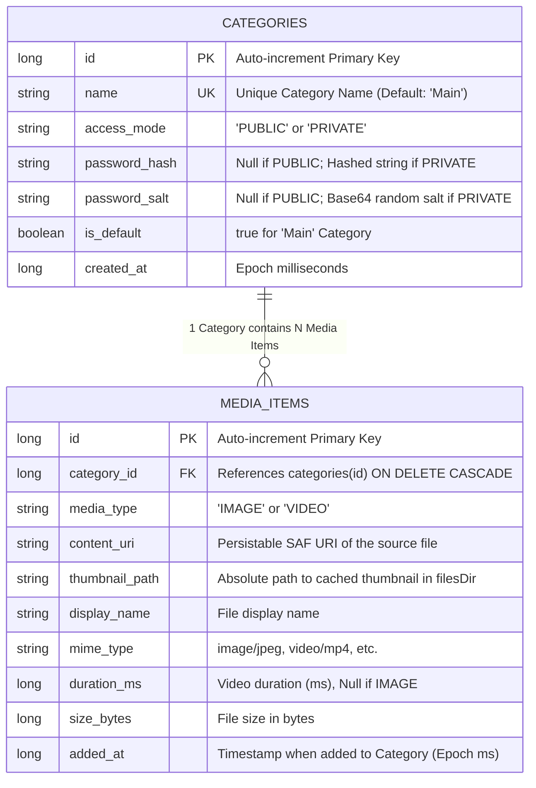

# 02. SQLite Database Schema (Room)

This document details the relational schema, foreign keys, indexes, and default seeding mechanism in SQLite for **MediaArchive**.

---

## 1. Entity-Relationship Diagram (ERD)



---

## 2. `categories` Table Specification

Stores the default `Main` Category and all user-created Categories.

| Column Name | SQLite Type | Constraints | Description |
| :--- | :--- | :--- | :--- |
| `id` | `INTEGER` | `PRIMARY KEY AUTOINCREMENT` | Unique Category identifier |
| `name` | `TEXT` | `NOT NULL UNIQUE COLLATE NOCASE` | Category name (e.g., `"Main"`, `"Travel"`, `"Vault"`) |
| `access_mode` | `TEXT` | `NOT NULL` | `"PUBLIC"` or `"PRIVATE"` |
| `password_hash` | `TEXT` | `NULLABLE` | Password digest (only populated when `access_mode = 'PRIVATE'`) |
| `password_salt` | `TEXT` | `NULLABLE` | Base64-encoded 16-byte random salt |
| `is_default` | `INTEGER` | `NOT NULL DEFAULT 0` | `1` (`true`) for `"Main"`, `0` (`false`) for custom categories |
| `created_at` | `INTEGER` | `NOT NULL` | Creation timestamp (epoch ms) |

### Seeding the Default `Main` Category:
- Executed via `RoomDatabase.Callback.onCreate()` and verified at startup (`ensureDefaultCategoryExists()`):
  ```sql
  INSERT OR IGNORE INTO categories (name, access_mode, password_hash, password_salt, is_default, created_at)
  VALUES ('Main', 'PUBLIC', NULL, NULL, 1, strftime('%s','now') * 1000);
  ```
- Queries always order by `is_default DESC, created_at ASC` so `Main` appears first.

---

## 3. `media_items` Table Specification

Stores the source URI (`content_uri`) and local thumbnail file path (`thumbnail_path`) for each image or video assigned to a Category.

| Column Name | SQLite Type | Constraints | Description |
| :--- | :--- | :--- | :--- |
| `id` | `INTEGER` | `PRIMARY KEY AUTOINCREMENT` | Unique media item identifier |
| `category_id` | `INTEGER` | `NOT NULL REFERENCES categories(id) ON DELETE CASCADE` | Owning Category ID |
| `media_type` | `TEXT` | `NOT NULL` | `"IMAGE"` or `"VIDEO"` (powers the 2 separate tabs) |
| `content_uri` | `TEXT` | `NOT NULL` | Persistable SAF URI (`content://...`) |
| `thumbnail_path` | `TEXT` | `NOT NULL` | Internal file path (`.../files/thumbnails/<uuid>.webp`) |
| `display_name` | `TEXT` | `NOT NULL` | Display filename |
| `mime_type` | `TEXT` | `NOT NULL` | MIME type (`image/*` or `video/*`) |
| `duration_ms` | `INTEGER` | `NULLABLE` | Video duration in milliseconds (`NULL` for `IMAGE`) |
| `size_bytes` | `INTEGER` | `NOT NULL DEFAULT 0` | File size in bytes |
| `added_at` | `INTEGER` | `NOT NULL` | Insertion timestamp (epoch ms) |

### Indexes & Unique Constraints:
1. **`index_media_items_category_id_media_type_added_at`**:
   - Composite index on `(category_id, media_type, added_at DESC)`.
   - Enables instant $O(\log N)$ switching between the **Images** and **Videos** tabs.
2. **`index_media_items_category_id_content_uri` (UNIQUE)**:
   - Enforces `UNIQUE(category_id, content_uri)` with `OnConflictStrategy.IGNORE`.
   - Prevents duplicate entries if a user re-imports the same file or folder into the same Category.

---

## 4. Core DAO Queries

```kotlin
@Dao
interface MediaItemDao {

    @Query("""
        SELECT * FROM media_items
        WHERE category_id = :categoryId AND media_type = :mediaType
        ORDER BY added_at DESC, id DESC
    """)
    fun observeMediaByCategoryAndType(
        categoryId: Long,
        mediaType: String
    ): Flow<List<MediaItemEntity>>

    @Insert(onConflict = OnConflictStrategy.IGNORE)
    suspend fun insertMediaItems(items: List<MediaItemEntity>): List<Long>

    @Query("SELECT EXISTS(SELECT 1 FROM media_items WHERE category_id = :categoryId AND content_uri = :contentUri)")
    suspend fun existsInCategory(categoryId: Long, contentUri: String): Boolean
}
```
