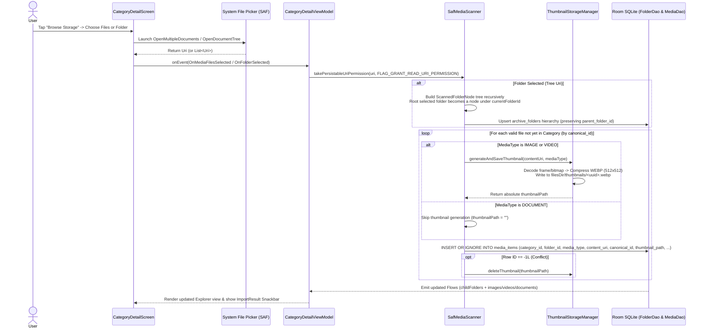

# 03. Media & Document Ingestion (SAF), Explorer Navigation & Playback Flows

This document specifies the end-to-end technical flows for:
1. **Manual storage browsing (single files or nested folders), canonical deduplication, and SQLite persistence**.
2. **Full-screen Image viewing (Swipe left/right) and Video playback (Previous / Next controller buttons)**.
3. **Explorer-style nested folder navigation inside Categories**.
4. **External Document opening (`ACTION_VIEW`) for Text, PDF, Word, Excel, and PowerPoint files**.

---

## 1. Manual Storage Browsing, Canonical Deduplication & Ingestion Flow

**MediaArchive** never scans device storage automatically. Inside `CategoryDetailScreen` (either at Category root or inside any opened subfolder), tapping **"Browse Storage"** presents two choices:
- **Select Files**: Uses `ActivityResultContracts.OpenMultipleDocuments()` with supported MIME types:
  - Images & Videos: `image/*`, `video/*`
  - Text & PDF: `text/*`, `application/pdf`, `application/rtf`
  - Office & OpenDocument:
    - Word: `application/msword`, `application/vnd.openxmlformats-officedocument.wordprocessingml.document`, `application/vnd.oasis.opendocument.text`
    - Excel: `application/vnd.ms-excel`, `application/vnd.openxmlformats-officedocument.spreadsheetml.sheet`, `application/vnd.oasis.opendocument.spreadsheet`
    - PowerPoint: `application/vnd.ms-powerpoint`, `application/vnd.openxmlformats-officedocument.presentationml.presentation`, `application/vnd.oasis.opendocument.presentation`
- **Select Folder**: Uses `ActivityResultContracts.OpenDocumentTree()`.

### File Type Classification (MIME + Extension Fallback)
`SafMediaScanner` resolves each file to `MediaType.IMAGE`, `MediaType.VIDEO`, or `MediaType.DOCUMENT`:
1. `mimeType.startsWith("image/")` -> `MediaType.IMAGE`
2. `mimeType.startsWith("video/")` -> `MediaType.VIDEO`
3. Document MIME types (`text/*`, `application/pdf`, `application/rtf`, `application/msword`, `application/vnd.ms-excel`, `application/vnd.ms-powerpoint`, `application/vnd.openxmlformats-officedocument.*`, `application/vnd.oasis.opendocument.*`) -> `MediaType.DOCUMENT`
4. **Extension fallback** (for SAF providers returning `application/octet-stream`): lowercase extension in `{txt, md, csv, json, xml, rtf, pdf, doc, docx, odt, xls, xlsx, ods, ppt, pptx, odp}` -> `MediaType.DOCUMENT`.
5. Unsupported files are skipped safely.

### Canonical SAF Deduplication (`SafCanonicalIdResolver`)
To prevent importing the same physical file twice across different SAF URI shapes (e.g., `OpenMultipleDocuments` single document URI vs `OpenDocumentTree` child document URI):
- If `DocumentsContract.isDocumentUri(context, uri)` -> `"${uri.authority}::${DocumentsContract.getDocumentId(uri)}"`
- Else if `DocumentsContract.isTreeUri(uri)` -> `"${uri.authority}::${DocumentsContract.getTreeDocumentId(uri)}"`
- Fallback -> normalized `uri.toString()`

Before generating thumbnails or inserting rows:
1. Deduplicate incoming URIs in-memory by `canonicalId`.
2. Skip any item where `mediaItemDao.existsByCanonicalId(categoryId, canonicalId)` is `true` (incrementing `skippedDuplicateCount`).
3. If `mediaItemDao.insertMediaItems(...)` returns `-1L` for any item due to a concurrent `UNIQUE(category_id, canonical_id)` conflict, immediately delete its newly generated `.webp` thumbnail to prevent orphan files.
4. Return `ImportResult(importedCount, skippedDuplicateCount)` so the UI can show clear Snackbar feedback.

### Ingestion Sequence Diagram



### Thumbnail Generation Specifications (Images & Videos Only)
1. **Target Resolution**: `512 x 512 px` (center-cropped or scaled down preserving aspect ratio) for crisp 1:1 grid rendering with minimal disk footprint (~15–30 KB per thumbnail).
2. **Compression Format**:
   - Android 11+ (API 30+): `Bitmap.CompressFormat.WEBP_LOSSY` at quality `80`.
   - Android 10 and below: `Bitmap.CompressFormat.WEBP` at quality `80`.
3. **Extraction Strategy**:
   - Primary (API 29+): `context.contentResolver.loadThumbnail(uri, Size(512, 512), null)`.
   - Fallback:
     - `VIDEO`: `MediaMetadataRetriever().apply { setDataSource(context, uri) }.getFrameAtTime(...)`.
     - `IMAGE`: `BitmapFactory.decodeStream` with sampled bounds (`inSampleSize`).
4. **Safe Naming & Cleanup**:
   - Stored as `<UUID.randomUUID()>.webp` inside `File(context.filesDir, "thumbnails")` alongside a `.nomedia` file.
   - Deleting a media item, an `ArchiveFolder` (recursively), or a Category deletes all associated `.webp` thumbnail files from internal storage.

---

## 2. Full-Screen Image Viewer Flow

When the user taps an image at `initialIndex` in the **Images Tab** (at Category root or inside a subfolder):
1. **Navigation**: Pass `categoryId`, `folderId` (nullable), `initialIndex`, and `isPrivate` to `ImageViewerScreen`.
2. **Data Source**: `ImageViewerViewModel` observes the ordered list of `IMAGE` items for `(categoryId, folderId)`.
3. **Swipe Gesture Navigation**:
   - Uses Jetpack Compose `HorizontalPager(state = pagerState)` starting at `initialIndex`.
   - Swiping left advances to the next image (`index + 1`); swiping right returns to the previous image (`index - 1`).
4. **Full-Screen Presentation**:
   - Tapping once toggles the visibility of the top overlay bar (filename + back button) and system bars.
   - Loads the full-resolution image from `content_uri` via Coil `AsyncImage`, using `thumbnail_path` as a placeholder.

---

## 3. Video Player Flow (Media3 ExoPlayer with Previous / Next Buttons)

When the user taps a video at `initialIndex` in the **Videos Tab** (at Category root or inside a subfolder):
1. **Navigation**: Pass `categoryId`, `folderId` (nullable), `initialIndex`, and `isPrivate` to `VideoPlayerScreen`.
2. **Playlist Initialization**:
   - `VideoPlayerViewModel` loads all `VIDEO` items belonging to `(categoryId, folderId)`.
   - Populates `ExoPlayer` with the playlist starting at `initialIndex`.
3. **Previous / Next Controls on Controller Bar**:
   - **Previous Button (`SkipPrevious`)**: `exoPlayer.seekToPreviousMediaItem()`.
   - **Play / Pause Button**.
   - **Next Button (`SkipNext`)**: `exoPlayer.seekToNextMediaItem()`.
   - **SeekBar & Time Indicators**: Current position, total duration, and video index indicator (e.g., `2 / 10`).

---

## 4. Explorer-Style Nested Folder Navigation Flow

Inside `CategoryDetailScreen`:
1. **Folder Stack State**: `CategoryDetailViewModel` tracks `folderStack: List<ArchiveFolder>` (empty at Category root; `currentFolderId = folderStack.lastOrNull()?.id`).
2. **Folder Import Placement**: When the user imports a folder via **"Browse Storage -> Select Folder"**, the selected folder itself is inserted as an `ArchiveFolder` at `currentFolderId`, with its nested subfolders and files stored beneath it.
3. **Breadcrumb & Back Navigation**:
   - When `folderStack.isNotEmpty()`, a horizontal scrollable breadcrumb bar displays `CategoryName > FolderA > SubFolderB`, allowing single-tap navigation back to root or any ancestor.
   - Pressing Android's system Back button (`BackHandler`) or the TopAppBar Back button pops one folder from `folderStack` until reaching Category root, after which Back exits `CategoryDetailScreen`.
4. **Tab Presentation at Any Folder Depth**:
   - **Images Tab**: 3-column 1:1 square grid showing child folders (uniform square folder tiles) followed by `IMAGE` items in `currentFolderId`.
   - **Videos Tab**: 3-column 1:1 square grid showing child folders (uniform square folder tiles) followed by `VIDEO` items in `currentFolderId`.
   - **Documents Tab**: Vertical `LazyColumn` showing child folders (`72.dp` height rows) followed by `DOCUMENT` items (`72.dp` height rows) in `currentFolderId`.

---

## 5. External Document Opening Flow (`ACTION_VIEW`)

When the user taps a document row in the **Documents Tab**:
1. `CategoryDetailViewModel` emits `CategoryDetailUiEffect.OpenDocumentExternally(contentUri, mimeType, displayName)`.
2. `CategoryDetailRoute` invokes `ExternalDocumentOpener.openDocument(context, uri, mimeType)`:
   ```kotlin
   val intent = Intent(Intent.ACTION_VIEW).apply {
       setDataAndType(Uri.parse(contentUri), resolvedMimeType)
       addFlags(Intent.FLAG_GRANT_READ_URI_PERMISSION)
   }
   val chooser = Intent.createChooser(intent, displayName)
   context.startActivity(chooser)
   ```
3. **Error Handling**:
   - If `ActivityNotFoundException` is thrown (no app on the device can open that MIME type), emit a Snackbar: *"No installed app can open this file"*.
   - If `SecurityException` occurs or `isMediaAccessible(contentUri)` is `false`, emit a Snackbar indicating the source file is no longer accessible and offer deletion.
