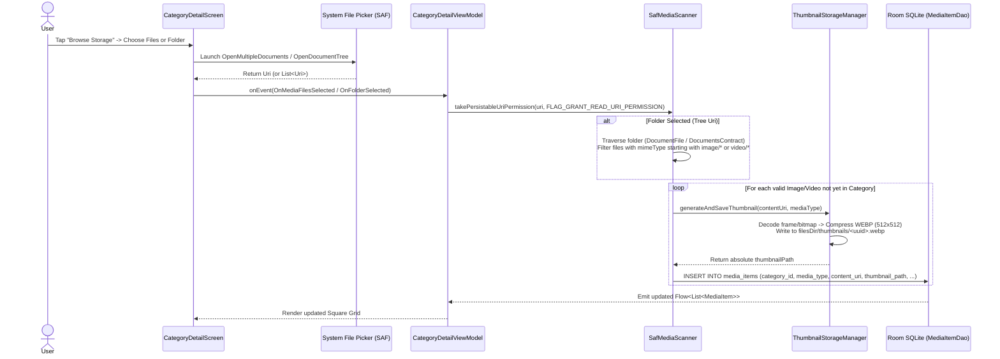

# 03. Media Ingestion (SAF), Thumbnail Caching & Playback Flows

This document specifies the end-to-end technical flows for:
1. **Manual storage browsing (single files or folders) and persisting paths + thumbnails in SQLite**.
2. **Full-screen Image viewing (Swipe left/right) and Video playback (Previous / Next controller buttons)**.

---

## 1. Manual Storage Browsing & Thumbnail Generation Flow

**MediaArchive** never scans device storage automatically. Inside `CategoryDetailScreen`, tapping **"Browse Storage"** presents two choices:
- **Select Images / Videos**: Uses `ActivityResultContracts.OpenMultipleDocuments()` with MIME types `arrayOf("image/*", "video/*")`.
- **Select Folder**: Uses `ActivityResultContracts.OpenDocumentTree()`.

### Ingestion Sequence Diagram



### Thumbnail Generation Specifications
1. **Target Resolution**: `512 x 512 px` (center-cropped or scaled down preserving aspect ratio) for crisp 1:1 grid rendering with minimal disk footprint (~15–30 KB per thumbnail).
2. **Compression Format**:
   - Android 11+ (API 30+): `Bitmap.CompressFormat.WEBP_LOSSY` at quality `80`.
   - Android 10 and below: `Bitmap.CompressFormat.WEBP` at quality `80`.
3. **Extraction Strategy**:
   - Primary (API 29+): `context.contentResolver.loadThumbnail(uri, Size(512, 512), null)`.
   - Fallback:
     - `VIDEO`: `MediaMetadataRetriever().apply { setDataSource(context, uri) }.getFrameAtTime(...)`.
     - `IMAGE`: `BitmapFactory.decodeStream` with sampled bounds (`inSampleSize`).
4. **Safe Naming & Cleanup**:
   - Stored as `<UUID.randomUUID()>.webp` inside `File(context.filesDir, "thumbnails")` alongside a `.nomedia` file.
   - Deleting a media item or Category also deletes its associated `.webp` thumbnail files from internal storage.

---

## 2. Full-Screen Image Viewer Flow

When the user taps an image at `initialIndex` in the **Images Tab**:
1. **Navigation**: Pass `categoryId` and `initialIndex` to `ImageViewerScreen`.
2. **Data Source**: `ImageViewerViewModel` observes the ordered list of `IMAGE` items for `categoryId`.
3. **Swipe Gesture Navigation**:
   - Uses Jetpack Compose `HorizontalPager(state = pagerState)`.
   - `pagerState` starts at `initialIndex`.
   - Swiping left advances to the next image (`index + 1`); swiping right returns to the previous image (`index - 1`).
4. **Full-Screen Presentation**:
   - Tapping once toggles the visibility of the top overlay bar (filename + back button) and system bars.
   - Loads the full-resolution image from `content_uri` via Coil `AsyncImage`, using `thumbnail_path` as a placeholder to eliminate black flashes.

---

## 3. Video Player Flow (Media3 ExoPlayer with Previous / Next Buttons)

When the user taps a video at `initialIndex` in the **Videos Tab**:
1. **Navigation**: Pass `categoryId` and `initialIndex` to `VideoPlayerScreen`.
2. **Category Playlist Initialization**:
   - `VideoPlayerViewModel` loads all `VIDEO` items belonging to `categoryId`.
   - Converts them into `androidx.media3.common.MediaItem` instances and populates `ExoPlayer`:
     ```kotlin
     val media3Items = categoryVideos.map { video ->
         androidx.media3.common.MediaItem.Builder()
             .setMediaId(video.id.toString())
             .setUri(Uri.parse(video.contentUri))
             .setMediaMetadata(
                 MediaMetadata.Builder()
                     .setTitle(video.displayName)
                     .build()
             )
             .build()
     }
     exoPlayer.setMediaItems(media3Items, startIndex, C.TIME_UNSET)
     exoPlayer.prepare()
     exoPlayer.playWhenReady = true
     ```
3. **Previous / Next Controls on Controller Bar**:
   - The Video Player controller bar displays dedicated buttons:
     - **Previous Button (`SkipPrevious`)**: Invokes `exoPlayer.seekToPreviousMediaItem()` to play the previous video in the Category (enabled when `hasPreviousMediaItem()` is true).
     - **Play / Pause Button**.
     - **Next Button (`SkipNext`)**: Invokes `exoPlayer.seekToNextMediaItem()` to play the next video in the Category (enabled when `hasNextMediaItem()` is true).
     - **SeekBar & Time Indicators**: Current position, total duration, and video index indicator (e.g., `2 / 10`).
