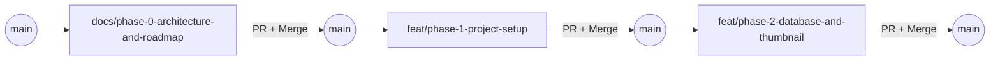

# Git & GitHub Workflow Guide

This document defines the branching strategy, commit message conventions, and Pull Request workflow for **MediaArchive**.

---

## 1. Branching Strategy (GitHub Flow)

The repository uses a clean **GitHub Flow** model where `main` is always buildable and stable:



### Official Branch Names by Phase

| Phase | Branch Name | Purpose |
| :--- | :--- | :--- |
| **Phase 0 (Docs)** | `docs/phase-0-architecture-and-roadmap` | Project rules, architecture, ADRs, naming standards, and 7-phase roadmap |
| **Phase 1** | `feat/phase-1-project-setup` | Android project setup, Gradle Version Catalog, Multi-Theme, 3-Language localization (`en`/`vi`/`ja`), Settings & About screens |
| **Phase 2** | `feat/phase-2-database-and-thumbnail` | Room SQLite (`categories`, `media_items`), Default `Main` seed, and Thumbnail engine |
| **Phase 3** | `feat/phase-3-category-and-auth` | Category list, `public`/`private` creation, and unrestricted password verification |
| **Phase 4** | `feat/phase-4-media-grid-and-saf-browser` | Category detail with 2 separate Square Grid tabs (Images / Videos) and SAF file/folder browser |
| **Phase 5** | `feat/phase-5-image-pager-and-video-player` | Full-screen swipe Image Viewer (`HorizontalPager`) and Media3 Video Player with Previous/Next controls |
| **Phase 6** | `feat/phase-6-polish-and-testing` | Missing file handling, Media/Category deletion, grid performance tuning, and Unit/UI tests |
| **Phase 7** | `sec/phase-7-source-security-hardening` | Source code security audit, `FLAG_SECURE`, SAF path safety, and Manifest/R8 hardening |

### Additional Branch Prefixes (`<type>/<short-description>`)
- `fix/<bug-description>`: Bug fixes (e.g., `fix/video-player-next-button-state`).
- `refactor/<scope>`: Code restructuring without behavior changes.
- `docs/<scope>`: Documentation updates.
- `test/<scope>`: Adding or updating automated tests.

---

## 2. Commit Message Convention (Conventional Commits)

All commit messages must be written in **English** using the **Conventional Commits** format:

```text
<type>(<scope>): <concise summary under 72 characters>

[optional body explaining why the change was made]
```

### Allowed `<type>` values:
- `feat`: New feature implementation.
- `fix`: Bug fix.
- `docs`: Documentation and ADR updates.
- `refactor`: Code refactoring.
- `test`: Unit or UI tests.
- `chore`: Gradle, dependencies (`libs.versions.toml`), or build scripts.
- `sec`: Security hardening and privacy improvements.

### Allowed `<scope>` values:
- `core`, `theme`, `i18n`, `settings`, `about`, `db`, `saf`, `thumbnail`, `category`, `grid`, `image-viewer`, `video-player`, `security`, `arch`.

### Examples:
- `docs(arch): add project hard rules, architecture, ADRs, naming conventions and 7-phase roadmap`
- `feat(theme): implement neutral taupe default theme and deep crimson/forest/sapphire palettes`
- `feat(i18n): add English, Vietnamese and Japanese localization with runtime switcher in settings`
- `feat(db): create categories and media_items tables with default Main category seed`
- `feat(category): implement public and private category creation with unrestricted password`
- `feat(saf): support single media and full folder ingestion with thumbnail caching`
- `sec(security): enable FLAG_SECURE for private categories and hash passwords with salt`

---

## 3. Step-by-Step Session Workflow

For every implementation session:

1. **Sync `main` and checkout the Phase branch**:
   ```powershell
   git checkout main
   git pull origin main
   git checkout -b <phase-branch-name>
   ```
2. **Read `AGENTS.md` and the Phase specification** in `docs/roadmap/implementation-phases.md`.
3. **Implement and verify locally**:
   - Run `./gradlew assembleDebug` and `./gradlew testDebugUnitTest`.
4. **Commit and open a Pull Request**:
   ```powershell
   git push -u origin <phase-branch-name>
   gh pr create --base main --head <phase-branch-name>
   ```
5. **Merge PR and tag release milestone** (`v0.1.0-phase1` ... `v1.0.0`).
