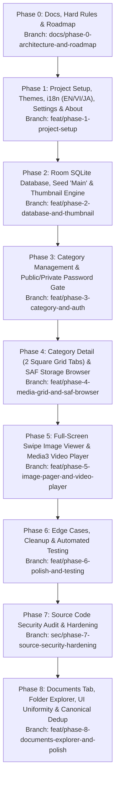

# Project Implementation Roadmap (8 Phases)

This document breaks down the development of **MediaArchive** into **8 sequential, self-contained Phases**, complete with **dedicated Git branch names** and clear acceptance criteria for each coding session.

---

## 1. Phase & Git Branch Mapping Table

| Phase | Core Focus | Git Branch Name | Target Tag |
| :--- | :--- | :--- | :--- |
| **Phase 0** | Hard Rules, Architecture, ADRs, Design System, Naming Standards & Roadmap | `docs/phase-0-architecture-and-roadmap` | `v0.0.1-docs` |
| **Phase 1** | Project Setup, Multi-Theme Palettes (Neutral + Deep Tones), 3 Languages (`en`/`vi`/`ja`), `Settings` & Concise `About` Screen | `feat/phase-1-project-setup` | `v0.1.0-phase1` |
| **Phase 2** | SQLite Database (Room), Default `Main` (`public`) Seed, Password Hasher & Thumbnail Engine | `feat/phase-2-database-and-thumbnail` | `v0.2.0-phase2` |
| **Phase 3** | Category Management (`public`/`private`) & Unrestricted Password Authentication Gate | `feat/phase-3-category-and-auth` | `v0.3.0-phase3` |
| **Phase 4** | Category Detail (2 Separate Tabs: Images/Videos Square Grid) & Manual SAF Storage Browser (Files & Folders) | `feat/phase-4-media-grid-and-saf-browser` | `v0.4.0-phase4` |
| **Phase 5** | Full-Screen Image Viewer (`HorizontalPager` Swipe) & Video Player (`Media3 ExoPlayer` with Previous/Next Buttons) | `feat/phase-5-image-pager-and-video-player` | `v0.5.0-phase5` |
| **Phase 6** | Missing File Handling, Media/Category Deletion, Grid Optimization & Automated Unit/UI Tests | `feat/phase-6-polish-and-testing` | `v0.6.0-phase6` |
| **Phase 7** | Source Code Security Audit & Local Storage Hardening (`FLAG_SECURE`, Crypto, SAF Safety, Manifest/R8) | `sec/phase-7-source-security-hardening` | `v1.0.0` |
| **Phase 8** | Office Documents Tab, Explorer-Style Nested Folders, `CategoryCard` Uniform Height & Canonical SAF Deduplication | `feat/phase-8-documents-explorer-and-polish` | `v1.1.0` |

---

## 2. Roadmap Flow Diagram

---

## Phase 1: Project Initialization, Multi-Theme System, Localization (`en`/`vi`/`ja`), `Settings` & `About` Screen

- **Git Branch**: `feat/phase-1-project-setup`
- **Branch Command**: `git checkout -b feat/phase-1-project-setup dev`
- **Suggested Commit**: `feat(core): initialize android project with multi-theme palettes, EN/VI/JA localization, settings and about screen`

### Goal:
Bootstrap the Android Kotlin 2.x + Jetpack Compose (Material 3) project, configure Hilt, Room, DataStore, Coil, and Media3 dependencies, and implement the complete Design System (Default Neutral Taupe + Deep accent palettes), 3-language localization (`en`, `vi`, `ja`), `SettingsScreen`, and concise `AboutScreen`.

### Tasks:
1. Configure Gradle (`settings.gradle.kts`, `build.gradle.kts`, `gradle/libs.versions.toml`) with Compose, Hilt, Room, DataStore Preferences, AppCompat (for per-app locales), Navigation Compose, Coil 3, Media3, and DocumentFile.
2. Implement `MediaArchiveTheme` supporting 4 color palettes:
   - `NEUTRAL_TAUPE` *(Default: White, Black, Taupe / Brownish Gray)*
   - `DEEP_CRIMSON` *(Deep Crimson Red)*
   - `DEEP_FOREST` *(Deep Forest Green)*
   - `DEEP_SAPPHIRE` *(Deep Navy / Sapphire Blue)*
3. Create complete string resource files for all 3 languages:
   - `res/values/strings.xml` (English)
   - `res/values-vi/strings.xml` (Vietnamese)
   - `res/values-ja/strings.xml` (Japanese)
4. Implement `UserPreferencesRepository` (DataStore) and `SettingsScreen` to allow switching the **Color Theme** and **App Language** at runtime.
5. Implement `AboutScreen` introducing only user-facing app functionality concisely (strictly no mention of architecture or tech stack).

### Definition of Done (DoD):
- `./gradlew assembleDebug` succeeds.
- Users can open `SettingsScreen`, switch between Neutral Taupe, Deep Crimson, Deep Forest, and Deep Sapphire themes, and switch languages between English, Vietnamese, and Japanese immediately.
- `AboutScreen` displays a clean, non-technical summary of the app in all 3 languages.

---

## Phase 2: SQLite Database (Room), Default `Main` Category Seed & Thumbnail Engine

- **Git Branch**: `feat/phase-2-database-and-thumbnail`
- **Branch Command**: `git checkout -b feat/phase-2-database-and-thumbnail dev`
- **Suggested Commit**: `feat(db): implement room schema, default Main category seed and thumbnail storage engine`

### Goal:
Implement the SQLite database layer using Room, automatically seed the default `Main` (`public`) Category, and build the SAF scanner and private thumbnail extraction engine.

### Tasks:
1. Define Domain models (`Category`, `AccessMode`, `MediaItem`, `MediaType`) and Repository interfaces (`CategoryRepository`, `MediaRepository`).
2. Implement Room Entities & DAOs:
   - `CategoryEntity` and `CategoryDao`.
   - `MediaItemEntity` and `MediaItemDao` with composite index `(category_id, media_type, added_at DESC)` and unique constraint `(category_id, content_uri)`.
3. Configure `MediaArchiveDatabase` to seed the default Category (`name = "Main"`, `access_mode = "PUBLIC"`, `is_default = true`).
4. Implement `PasswordHasher` (salted hash supporting any non-empty password `length >= 1`).
5. Implement `ThumbnailStorageManager`:
   - Initialize `context.filesDir/thumbnails/` and create `.nomedia`.
   - Extract `512x512` thumbnails from image and video `content://` URIs, compress to `.webp`, save as `<uuid>.webp`, and return `thumbnailPath`.
6. Implement `SafMediaScanner` to take persistable URI permissions and scan single files (`OpenMultipleDocuments`) or entire folders (`OpenDocumentTree`).

### Definition of Done (DoD):
- Unit tests verify that `Main` (`PUBLIC`) is seeded automatically and cannot be deleted.
- Unit tests verify that `PasswordHasher` accepts 1-character / 1-digit passwords and validates them accurately.
- Thumbnail generation writes `.webp` files to `filesDir/thumbnails/` and persists paths in SQLite.

---

## Phase 3: Category Management (`public` / `private`) & Password Gate

- **Git Branch**: `feat/phase-3-category-and-auth`
- **Branch Command**: `git checkout -b feat/phase-3-category-and-auth dev`
- **Suggested Commit**: `feat(category): implement public and private category management with unrestricted password gate`

### Goal:
Build the main Category list screen requiring users to select a Category before browsing media, with support for creating custom `public` or `private` Categories and prompting for passwords on `private` Categories.

### Tasks:
1. Implement `GetCategoriesUseCase`, `CreateCategoryUseCase`, and `VerifyCategoryPasswordUseCase`.
2. Build `CategoryListViewModel` and `CategoryListScreen`:
   - Display `Main` first, followed by custom Categories with clear `Public` / `Private` (lock icon) indicators.
   - Provide top bar actions to open `SettingsScreen` and `AboutScreen`.
3. Build `CreateCategoryDialog`:
   - Input Category name and select `Public` or `Private`.
   - When `Private` is selected, require a password where **any non-empty string (`isNotEmpty()`) is accepted** (no minimum length or complexity rules).
4. Build `PasswordPromptDialog`:
   - Tapping a `PUBLIC` Category navigates directly to `CategoryDetailScreen`.
   - Tapping a `PRIVATE` Category opens `PasswordPromptDialog` and navigates only when the entered password matches.

### Definition of Done (DoD):
- Default `Main` Category is immediately accessible on first launch.
- Users can create `public` and `private` Categories (including 1-character or 1-digit passwords) and unlock `private` Categories via the password dialog.

---

## Phase 4: Category Detail (2 Separate Square Grid Tabs) & Manual Storage Browser (SAF)

- **Git Branch**: `feat/phase-4-media-grid-and-saf-browser`
- **Branch Command**: `git checkout -b feat/phase-4-media-grid-and-saf-browser dev`
- **Suggested Commit**: `feat(grid): implement dual image/video square grid tabs and manual SAF file and folder ingestion`

### Goal:
Build `CategoryDetailScreen` featuring 2 separate tabs (**Images** and **Videos**) rendered as a 1:1 Square Grid, plus the **"Browse Storage"** button to import individual files or an entire folder into SQLite.

### Tasks:
1. Implement `GetMediaByCategoryUseCase`, `ImportSelectedMediaUseCase`, and `ImportFolderMediaUseCase`.
2. Build `CategoryDetailViewModel` and `CategoryDetailScreen`:
   - `TabRow` with 2 separate tabs: **Images** and **Videos**.
   - `LazyVerticalGrid(columns = GridCells.Fixed(3))` where every item is a 1:1 square (`Modifier.aspectRatio(1f)`) loading `item.thumbnailPath` via Coil.
   - Video grid cells display a play badge and formatted duration (`mm:ss`).
3. Integrate **"Browse Storage"**:
   - Clicking **"Browse Storage"** lets the user choose between:
     1. **Select Images / Videos** (`OpenMultipleDocuments`): Extracts thumbnails and saves `content_uri` + `thumbnail_path` for each selected file into SQLite.
     2. **Select Folder** (`OpenDocumentTree`): Scans all images and videos inside the folder, extracts thumbnails, and saves all `content_uri` + `thumbnail_path` records into SQLite.
   - Show an import progress indicator while thumbnails are being generated.

### Definition of Done (DoD):
- Switching between the Images and Videos tabs displays only the matching media type in a 1:1 square grid.
- Selecting individual files or a folder saves paths + thumbnails to SQLite and updates the grid reactively.
- Media items and thumbnails persist across app restarts.

---

## Phase 5: Full-Screen Swipe Image Viewer & Media3 Video Player

- **Git Branch**: `feat/phase-5-image-pager-and-video-player`
- **Branch Command**: `git checkout -b feat/phase-5-image-pager-and-video-player dev`
- **Suggested Commit**: `feat(viewer): implement full-screen swipe image pager and media3 video player with prev/next buttons`

### Goal:
Deliver the full-screen Image Viewer (swipe left/right to navigate) and the Video Player (tap Previous / Next buttons on the controller bar to navigate).

### Tasks:
1. **Full-Screen Image Viewer (`ImageViewerScreen` & `ImageViewerViewModel`)**:
   - Open at the tapped image's position using Compose `HorizontalPager`.
   - Support horizontal swiping to view the previous or next image in the same Category, pinch-to-zoom, and tap-to-toggle system bars.
2. **Video Player (`VideoPlayerScreen` & `VideoPlayerViewModel`)**:
   - Integrate `AndroidX Media3 ExoPlayer` loaded with the Category's video playlist starting at the tapped video.
   - Provide a controller bar with explicit **Previous Video (`seekToPreviousMediaItem()`)**, **Play/Pause**, **Next Video (`seekToNextMediaItem()`)**, and **SeekBar** controls.
   - Properly pause playback on `ON_STOP` and release `ExoPlayer` when exiting the screen.

### Definition of Done (DoD):
- Tapping an image opens full-screen mode and swiping left/right navigates through Category images smoothly.
- Tapping a video plays it immediately, and tapping Previous / Next on the controller switches to the previous or next video in the Category.

---

## Phase 6: Edge Cases, Cleanup & Automated Testing

- **Git Branch**: `feat/phase-6-polish-and-testing`
- **Branch Command**: `git checkout -b feat/phase-6-polish-and-testing dev`
- **Suggested Commit**: `feat(polish): handle missing external files, thumbnail cleanup and add unit test suite`

### Goal:
Handle external file deletions gracefully, allow removing media items or custom Categories (with thumbnail file cleanup), and add unit tests.

### Tasks:
1. Detect when an external source file (`content_uri`) has been deleted or moved outside the app and allow removing the broken entry cleanly.
2. Support deleting individual media items or custom Categories (excluding `Main`) and automatically delete their `.webp` thumbnails from `filesDir/thumbnails/`.
3. Write unit tests for UseCases, ViewModels, PasswordHasher, and Room DAOs.

### Definition of Done (DoD):
- No crashes when external files are deleted outside the app.
- `./gradlew testDebugUnitTest` passes 100%.

---

## Phase 7: Source Code Security Audit & Local Storage Hardening

- **Git Branch**: `sec/phase-7-source-security-hardening`
- **Branch Command**: `git checkout -b sec/phase-7-source-security-hardening dev`
- **Suggested Commit**: `sec(security): enforce FLAG_SECURE on private categories, disable backup and complete security audit`

### Goal:
Conduct a comprehensive security audit of the source code and local storage handling to protect `private` Categories, thumbnails, and SAF URI operations.

### Security Audit & Hardening Tasks:
1. **Password Cryptography Verification**:
   - Verify that no plain-text or weakly encoded passwords exist anywhere; enforce `PBKDF2WithHmacSHA256` (or salted `SHA-256`) with 16-byte `SecureRandom` salts and constant-time comparison (`MessageDigest.isEqual`).
   - Verify that unlocking a `private` Category is strictly session-scoped in memory and resets upon returning to `CategoryListScreen`.
2. **Screen Protection (`FLAG_SECURE`) & Thumbnail Sandbox Isolation**:
   - Automatically apply `WindowManager.LayoutParams.FLAG_SECURE` whenever viewing a `PRIVATE` Category (Grid, Image Viewer, and Video Player) to block screenshots and hide content in the Recent Apps switcher.
   - Verify all thumbnails are stored exclusively in `context.filesDir/thumbnails/` with `.nomedia`.
3. **Path Traversal & SQL Injection Prevention**:
   - Verify that thumbnail filenames use `UUID.randomUUID().toString() + ".webp"` and never concatenate untrusted `displayName` strings from SAF URIs.
   - Verify that all Room DAO queries use parameterized bindings (`:param`) and all `ContentResolver` calls handle `SecurityException` safely.
4. **Manifest, Logcat & R8 Release Hardening**:
   - Set `android:allowBackup="false"` and configure `dataExtractionRules` in `AndroidManifest.xml`.
   - Ensure no component has `android:exported="true"` except `MainActivity`.
   - Remove or strip any log statements containing passwords, URIs, or filenames of `private` Categories in Release builds and configure R8 (`isMinifyEnabled = true`).

### Definition of Done (DoD):
- 100% of items in the Security Audit Checklist are verified and passed.
- Opening a `private` Category activates `FLAG_SECURE` in the Recent Apps switcher, and SQLite inspection reveals only salted hashes.

---

## Phase 8: Office Documents Tab, Explorer-Style Nested Folders, `CategoryCard` Uniform Height & Canonical SAF Deduplication

- **Git Branch**: `feat/phase-8-documents-explorer-and-polish`
- **Branch Command**: `git checkout -b feat/phase-8-documents-explorer-and-polish dev`
- **Suggested Commit**: `feat(documents): add documents tab, explorer nested folders, canonical saf deduplication and uniform category card height`
- **Reference ADR**: [ADR-006](../decisions/ADR-006-documents-folder-explorer-and-deduplication.md)

### Goal:
Extend **MediaArchive** with Office/Text/PDF document support (opened via installed external Android apps), Explorer-style nested folder browsing when importing folders via SAF, a dedicated 3rd **Documents** tab with uniform-height rows and extension badges, uniform `CategoryCard` height on `CategoryListScreen`, and canonical SAF deduplication.

### Tasks:
1. **Domain Layer Updates**:
   - Add `DOCUMENT` to `MediaType` (`IMAGE`, `VIDEO`, `DOCUMENT`).
   - Add `ArchiveFolder` domain model (`id`, `categoryId`, `parentFolderId`, `name`, `treeUri`, `addedAt`).
   - Add `folderId: Long?` to `MediaItem` and introduce `ImportResult(val importedCount: Int, val skippedDuplicateCount: Int)`.
   - Add `ArchiveFolderRepository` (or extend `MediaRepository`) and UseCases: `GetChildFoldersUseCase`, `DeleteArchiveFolderUseCase`, and update `GetMediaByCategoryUseCase` / `ImportSelectedMediaUseCase` / `ImportFolderMediaUseCase` to accept `folderId: Long?` and return `Result<ImportResult>`.
2. **Room Database v2 & `MIGRATION_1_2`**:
   - Add `ArchiveFolderEntity` and `ArchiveFolderDao` (including recursive CTE `getDescendantThumbnailPaths`).
   - Update `MediaItemEntity` with `folder_id` (nullable FK to `archive_folders` `ON DELETE CASCADE`) and `canonical_id` (`UNIQUE(category_id, canonical_id)`).
   - Bump `MediaArchiveDatabase` to `version = 2`, implement `MIGRATION_1_2`, and register `.addMigrations(MediaArchiveDatabase.MIGRATION_1_2)` in `DatabaseModule`.
3. **SAF Scanner, Canonical Deduplication & External Document Opener**:
   - Implement `SafCanonicalIdResolver` (`authority::documentId` for document/tree URIs, fallback to normalized URI).
   - Update `SafMediaScanner` to classify `DOCUMENT` files by MIME type + lowercase extension fallback, and return a recursive `ScannedFolderNode` tree instead of flattening folders.
   - Update `MediaRepositoryImpl` to:
     - Deduplicate in-batch and against `existsByCanonicalId(categoryId, canonicalId)`.
     - Skip `.webp` thumbnail generation for `MediaType.DOCUMENT` (`thumbnailPath = ""`).
     - Delete newly created orphan thumbnails whenever `insertMediaItems` returns `-1L`.
     - Create the selected folder as an `ArchiveFolder` at `currentFolderId` and recursively persist child folders and files.
     - Collect and delete descendant thumbnails when deleting an `ArchiveFolder`.
   - Implement `ExternalDocumentOpener` using `Intent(Intent.ACTION_VIEW)` + `FLAG_GRANT_READ_URI_PERMISSION` + `Intent.createChooser(...)`, handling `ActivityNotFoundException` and `SecurityException`.
4. **Category Detail Explorer UI & 3rd Tab ("Documents")**:
   - Update `CategoryDetailViewModel` / `CategoryDetailContract` to track `folderStack: List<ArchiveFolder>`, observe `childFolders` + `images` + `videos` + `documents` for `(categoryId, currentFolderId)`, and emit `OpenDocumentExternally` / `ShowNoAppForDocument` / `ImportResult` effects.
   - Update `CategoryDetailScreen`:
     - Expand `OpenMultipleDocuments` MIME array to include images, videos, text, PDF, Word, Excel, PowerPoint, and OpenDocument types.
     - Add 3rd tab (**Documents**) in `PrimaryTabRow`.
     - Add breadcrumb bar when `folderStack.isNotEmpty()` and intercept system/TopAppBar Back (`BackHandler`) to step up one folder level.
     - Add `FolderSquareGridItem` (for Images/Videos tabs), `FolderListItem` (`72.dp` fixed height), and `DocumentListItem` (`72.dp` fixed height, `44.dp` color-coded extension badge, single-line `TextOverflow.Ellipsis` filename, `EXT • size` subtitle).
   - Pass optional `folderId: Long?` to `AppDestination.ImageViewer` and `AppDestination.VideoPlayer` so viewer navigation scopes to the current folder.
5. **Category List Uniform Height Fix**:
   - Update `CategoryCard.kt` inner `Row` to `Modifier.fillMaxWidth().height(72.dp).padding(horizontal = 16.dp)` with `Alignment.CenterVertically` so `Main` and all custom `Public`/`Private` cards render at identical height.
6. **Localization (`en`, `vi`, `ja`) & Automated Tests**:
   - Add all new string resources (Documents tab, empty states, breadcrumb root, duplicate skip feedback, no-app-to-open-document error, folder delete dialog, updated Browse Storage labels) to `res/values/strings.xml`, `res/values-vi/strings.xml`, and `res/values-ja/strings.xml`.
   - Add unit tests for `SafCanonicalIdResolver`, `MediaRepositoryImpl` (deduplication, orphan thumbnail cleanup, recursive folder persistence & deletion), `CategoryDetailViewModel` (3 tabs + folder navigation stack), and `MIGRATION_1_2`.

### Definition of Done (DoD):
- `CategoryCard` height is uniform (`72.dp`) across `Main` and all custom `Public`/`Private` Categories.
- Selecting individual files or folders supports Images, Videos, Text, PDF, Word, Excel, and PowerPoint files, routing Documents to the 3rd **Documents** tab.
- Documents list rows have identical height (`72.dp`), distinct extension badges, single-line `...` truncation, and open in installed external apps via `ACTION_VIEW` (with graceful Snackbar fallback when no app is available).
- Importing a folder creates a browsable folder card at the current level and preserves nested subfolders/files recursively with Explorer-style navigation and Back/breadcrumb support.
- Selecting the same file via individual picker and folder picker never creates duplicates in the same Category, and `./gradlew testDebugUnitTest` passes 100%.
